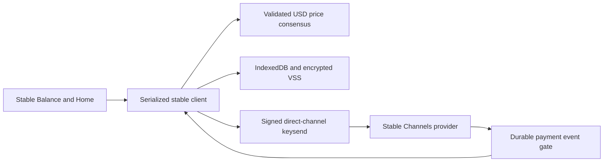

# Stable Channels USD balance

## Goal Capsule

**Objective:** A wallet user can allocate Lightning bitcoin to a provider-acknowledged USD position and have its bitcoin backing settle as the market moves.

**Means:** Implement the Stable Channels client wire protocol in the existing browser LDK node (KTD1).

**Authority:** The user's request to implement https://github.com/toneloc/stable-channels, then these requirements. Preserve existing wallet funds and recovery semantics. Implementation and local verification are authorized; deployment, funding a channel, and making mainnet trades are not part of local verification.

**Stop conditions:** Do not represent an unacknowledged trade, unavailable price, offline provider, or exhausted collateral as a stable dollar balance. Report unavailable live-provider verification explicitly.

## Product Contract

### Summary

Add a Stable Balance screen, provider funding through LSPS2, signed USD-target trades, and automatic signed settlement. Per the user's follow-up, Home prioritizes the acknowledged USD balance and shows the same value converted to sats at the latest BTC price below it; the detailed Balance screen retains the measured bitcoin total. A known empty dollar position shows $0.00 and zero sats, while an unknown recovered position stays unavailable.

### Problem Frame

Zinqq currently holds bitcoin exposure only. Stable Channels provides bilateral USD exposure through a collateralized Lightning provider; a cosmetic currency conversion would leave that exposure unchanged.

### Requirements

- **R1:** A user explicitly selects a provider and requests a funding invoice or uses an existing ready channel to that provider. Upstream public provider is offered with configurable node/host/port. Do not silently replace the existing receive LSP or trust unrelated peers.
- **R2:** Quote a USD allocation and its upstream 1% trade fee using fresh BTC/USD consensus. Show the fee before explicit confirmation. Enforce the upstream 99% post-fee capacity limit and 50-sat client margin. Keep native bitcoin and on-chain bitcoin distinct.
- **R3:** Send signed `TRADE_V1` via keysend TLV 13377331. Persist the intent before sending. Apply a target only after an authenticated, channel-bound, correlated `SYNC_V1`; payment success alone is not trade acceptance. Keep an ambiguous result pending rather than blindly retrying its fee.
- **R4:** Settle above-target backing to the provider via signed TLV 13377333; below-target backing waits for the provider's payment. Use the upstream 0.1% and $0.25 thresholds and 120-second cooldown. Preserve backing until payment success. Classify ordinary payments as native BTC rather than settlement.
- **R5:** Verify provider signatures over exact payload bytes with LDK message signing. Validate channel, direction, amount, expiry, target, monotonic sync version, and replay identifiers. Derive backing locally from accepted prices; never trust a peer-provided backing allocation.
- **R6:** Use at least three independent agreeing USD exchange markets, reject 5% outliers, expire prices after 60 seconds, and quarantine >10% moves relative to a still-fresh prior quote. Price failure blocks trades and settlement; show actual status. No unverified USDT fallback.
- **R7:** Persist target, backing, pending operations, and received settlement identities in IndexedDB and encrypted VSS under the wallet lock. Process financial events durably before acknowledging them to LDK. Stop new sends on stale chain sync, backup failure, backgrounding, pending HTLCs, or shutdown.
- **R8:** Show the acknowledged USD target, actual backing value, native BTC, and provider/channel/price status. Support reducing the USD target to zero and existing cooperative/force-close exits. Expose the same quote/commit/status actions to programmatic callers.

### Scope Boundaries

The feature stabilizes an allocated portion of one direct provider channel, not on-chain funds or unrelated channels. Require a single provider channel to avoid routing an accounting payment through a different channel. Currency is USD, matching upstream. No token, custody account, provider server implementation, splicing, or mainnet funding during tests. Offline browser tabs cannot continuously settle: expose that limitation.

### Acceptance Examples

- **AE1:** At $100,000/BTC, a confirmed $100 target has 100,000 sats of backing. At $110,000/BTC, pay the actionable excess to the provider; do not subtract it from backing until success.
- **AE2:** At $90,000/BTC, show awaiting-provider settlement; only an authenticated received settlement adds to backing. An ordinary incoming payment remains native BTC.
- **AE3:** A wrong signer/channel, stale sync, duplicate settlement, or mismatched trade correlation cannot change the target or backing.
- **AE4:** A crash after a prepared trade fee does not authorize paying it again. Restore the pending intent and accept its late signed result.

### Sources

- Upstream commit `128b6bcf87f9bcc36b53717f59667043fbf81a11`: `src/constants.rs`, `src/stable.rs`, `src/stabilization.rs`, `src/user.rs`, `server/stable-channels-lsp/src/messages.rs`.
- Installed `lightningdevkit` declarations for `UtilMethods`, `RecipientOnionFields`, `ChannelManager`, `Event_PaymentClaimed`, `PaymentParameters`, and `ReplayEvent`.
- `docs/solutions/integration-issues/ldk-event-handler-multi-lsp-trust-set.md` and `docs/solutions/integration-issues/ldk-wasm-lockedchannelmonitor-opaque-flat-balances-workaround.md`.

## Planning Contract

### Key Technical Decisions

- **KTD1:** Keep the browser node. Use LDK's Lightning message-sign/verify and spontaneous-payment custom TLVs; do not embed the Rust desktop wallet or change the wallet's seed.
- **KTD2:** User-entered targets use integer cents; allocation arithmetic uses integer nanodollars/sats/msats so fractional-cent provider reconciliation does not erase drift. Preserve the exact provider numeric target for signed replies and preserve raw signed payload bytes.
- **KTD3:** One serialized service owns stable state, persists remote first, and refuses to overwrite conflicting VSS state. Its lifetime follows the active LDK provider and wallet lock. A narrow payment-event replay gate holds LDK acknowledgement while the service writes a durable receipt inbox. Accounting waits for prices or pending payment outcomes outside the event callback: LDK stops at the first replay request, so waiting for a later payment event there would deadlock.
- **KTD4:** A fixed-market server endpoint fetches public USD prices; the client independently recomputes consensus from the returned observations and enforces quote freshness. No arbitrary upstream URL input. Reuse the existing API/Vite proxy pattern.
- **KTD5:** Reuse LSPS2 quote/buy with explicit funding confirmation; add the selected provider to the mutable trusted-provider set only after explicit provider selection. Reuse the existing channel-close flow. Keep ordinary receive behavior unchanged.

### High-Level Technical Design

## Implementation Units

### U1. Protocol and allocation arithmetic

**Goal:** Encode and validate upstream messages and calculate fees/backing without moving money.
**Requirements:** R2–R6. **Dependencies:** none.
**Files:** `src/stable/protocol.ts`, `src/stable/math.ts`, corresponding tests.
**Approach:** Derive upstream fees and drift-preserving allocation; parse a closed message vocabulary with exact correlation and replay checks.
**Patterns to follow:** `src/ldk/lsps2/types.ts`; installed WASM sign/verify APIs.
**Execution note:** Start with failing protocol/arithmetic tests, including real-WASM signing interoperability.
**Test scenarios:** Fee and capacity boundaries; rising/falling price; zero target; pending fee; corrupt signature; wrong channel; old version; duplicate and expired settlement; received overpayment remains native.
**Verification:** Protocol tests and actual WASM signing round trip pass.

### U2. Fresh market consensus

**Goal:** Supply independently checked fresh USD observations.
**Requirements:** R6. **Dependencies:** none.
**Files:** `api/stable-price.ts`, `api/stable-price.test.ts`, `src/stable/price.ts`, tests, `vite.config.ts`.
**Approach:** Fetch upstream USD markets with bounded request budgets and no cache reuse as a fresh quote; recompute median/outlier quorum in the client.
**Patterns to follow:** Existing Request/Response API handlers and API test includes.
**Test scenarios:** Three-market agreement; single outlier; missing quorum; invalid/old observations; large-move quarantine; timeout.
**Verification:** Fixed-market endpoint and client validation tests pass.

### U3. Durable settlement service

**Goal:** Execute trades and settlement through the running wallet and survive event replay.
**Requirements:** R1, R3–R5, R7. **Dependencies:** U1, U2.
**Files:** `src/stable/client.ts`, `src/stable/store.ts`, `src/stable/ldk.ts`, tests; `src/ldk/traits/event-handler.ts`, tests; `src/ldk/init.ts`, `src/ldk/context.tsx`; `src/storage/idb.ts`.
**Approach:** Serialize state transitions; store intent before single-path/no-fee keysend; apply successful outcomes durably; authenticate inbound custom records; withhold LDK acknowledgement until persistence; recover VSS state before event processing.
**Patterns to follow:** Wallet lock and close-record lifecycle; VSS compare-and-set; LDK send and event processing.
**Test scenarios:** AE1–AE4; failed/ambiguous sends; persistence failure; restarts; late results; unrelated payment; provider missing; stale chain; background tab; lost wallet lock; no double payment while pending.
**Verification:** Service tests cross storage/transport/event boundaries; existing payment/recovery tests remain green.

### U4. Stable Balance user flow

**Goal:** Let users fund, quote, confirm, and inspect a USD position.
**Requirements:** R1, R2, R8. **Dependencies:** U3.
**Files:** `src/pages/StableBalance.tsx`, tests; `src/stable/use-stable-balance.ts`; `src/pages/Home.tsx`, tests; `src/pages/Settings.tsx`; `src/routes/router.tsx`; `.env.example`, `README.md`.
**Approach:** Reuse room/field styling; show genuine readiness/errors; disclose fee and provider; require explicit confirmation; expose identical programmatic actions. Do not imply the total wallet is guaranteed USD.
**Patterns to follow:** Existing receive quote/review/commit, ScreenHeader, BalanceDisplay privacy toggle.
**Test scenarios:** No ready channel; quote fee disclosure; pending acknowledgement; active/stale/offline/depleted states; exit; balance hiding; existing Home/Receive/Send behavior.
**Verification:** Component tests and browser smoke checks at desktop/mobile widths.

## Verification Contract

Run targeted financial tests first, then app/proxy typechecks, lint, formatting, existing app suite, production build with an empty static-invoice-server path, and Chromium UI smoke tests. Verify real-WASM signatures and custom-TLV construction without sending payments. No funded live-provider acceptance is claimed from mocked or local tests.

## Definition of Done

All four units work through the real wallet integration; financial state is durable and replay-safe; the UI distinguishes a requested target from an accepted target and from actual funds; existing tests pass; abandoned experiments are removed. Record any missing live-provider verification and deployment prerequisites plainly.
